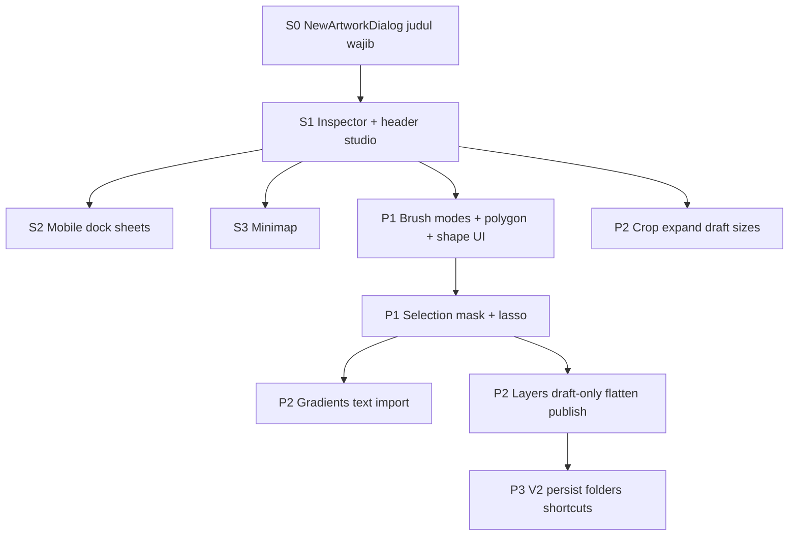

# THE COMMONS — Pixel Editor Implementation Roadmap (Wplace-inspired)

**Dokumen:** PIXEL-EDITOR-IMPLEMENTATION-ROADMAP.md  
**Tanggal:** 17 Nov 2026 · **Diperbarui:** 18 Nov 2026  
**Sifat:** Roadmap prioritas setelah audit. **Belum izin implementasi** sampai disetujui terpisah.  
**Dokumen terkait:** `PIXEL-STUDIO-REDESIGN-BLUEPRINT.md` (arah layout + modal create), `WPLACE-STUDIO-FEATURE-AUDIT.md`, `PIXEL-EDITOR-UI-UX-REDESIGN.md`, `PIXEL-EDITOR-TECHNICAL-ARCHITECTURE.md`, `PIXEL-RENDER-EXPORT-BLUEPRINT.md`.

**P0 chrome lama (rail + strip + zoom header) adalah fondasi parsial, bukan target.** Target workspace = blueprint S0–S3: modal create, inspector kanan, minimap, mobile sheet.

---

## 1. Prioritas

| Tier | Makna |
|---|---|
| **P0** | Fondasi workspace + stabilitas; sedikit/no schema change |
| **P1** | Editor utama setara “studio usable” tanpa layers penuh |
| **P2** | Advanced editing (termasuk layers draft-only) |
| **P3** | Productivity & polish |

---

## 2. Matriks fitur

| Feature | Current Status | Wplace Reference | Required Changes | Dependencies | Risk | Priority | Complexity |
|---|---|---|---|---|---|---|---|
| New artwork modal (title required, size, background, preview) | Belum (halaman `/create` tanpa judul) | New Overlay dialog | `NewArtworkDialog`; `createDraftSchema` tolak unnamed; seed fill Ink | `PixelNewForm`, copy, work-identity tests | Medium (tes + virgin draft) | P0 | Medium |
| Desktop inspector (palette + tool options + shortcuts) | Belum (strip palet/brush) | Right `editor-inspector` | `StudioInspector`; pindah palet/brush dari bawah | ColorPicker | Low | P0 | Medium |
| Desktop left tool rail + contextual strip | Sebagian (rail ada; strip masih) | Left toolbar + tool settings | Rail tetap; **hapus** strip sebagai akhiran — opsi masuk inspector | Design tokens | Low | P0 | Medium |
| Zoom widget (− / label / +) + grid in view chrome | Sebagian | Top zoom / pixel grid | Extract controls from More/status | PixelBoard zoom API | Low | P0 | Low |
| Canvas context menu (right-click / long-press) | Belum | Actions menu 1.6.5 | Menu component; wire undo/clipboard/view | Shortcuts map | Low | P0 | Medium |
| Shortcut cheat-sheet / tooltips with keys | Sebagian | Tooltips + Controls | Copy + `title`/tooltip UI | — | Low | P0 | Low |
| Minimap navigator | Belum | Live Preview 1.6.5 | Thumbnail from buffer; viewport mapping; collapse | Dirty flag + kamera | Medium (perf) | P1 | Medium |
| Collapsible color panel | Sebagian | Collapsible palette 1.6.9 | Bagian inspector; compact = warna aktif | ColorPicker | Low | P0 | Medium |
| Mobile inspector tabs + sheet | Belum (semua di toolbar bawah) | `editor-mobile-dock` tabs | Dock view + Palet/Alat sheets | S1 desktop inspector | Medium (touch vs pan) | P0 | Medium |
| Explicit fill/shape toggles (replace hidden Alt) | Sebagian | Shape tools UI | UI state filled vs stroke | rect/ellipse handlers | Low | P1 | Low |
| Square vs circle brush modes | Sebagian (disk only) | Square/circle brushes 1.6.0 | `stampBrush` modes + UI | Brush sizes | Low | P1 | Low |
| Polygon tool | Belum | Polygon 1.6.0 | Multi-click tool; bake to buffer | Undo push | Low | P1 | Medium |
| Lasso selection + mask | Belum | Selection suite | Selection mask model | Clipboard ops | Medium | P1 | High |
| Select by color / contiguous | Belum | Layer pixel select (notes) | Flood-based mask | Lasso/mask | Medium | P2 | Medium |
| Text tool → pixels | Belum | Text tool 1.6.9 | Font atlas or canvas text → quantize | Palette full handling | Medium | P2 | High |
| Linear/radial gradient + optional dither | Belum | Gradients 1.6.9 | Fill selection/layer; palette quantize | Selection | Medium | P2 | High |
| Crop / expand canvas | Belum | Canvas editing 1.6.0 | Allow dimension change on draft; rewrite source | Immutable size today | High | P2 | High |
| Image import as pixels/layer | Belum | Import images 1.6.0 | Decode PNG; quantize; size check | Area/palette caps | High | P2 | High |
| Layers runtime + flatten on publish (Opsi B) | Belum | Layers 1.6.0+ | Layer stack; IDB project; flatten export | Undo strategy | High | P2 | High |
| Layer panel UX (vis/lock/reorder/merge) | Belum | Layer panel | UI + commands | Layers B | High | P2 | High |
| Paste/duplicate → new layer | Belum | 1.6.9 | Clipboard → layer | Layers B | Medium | P2 | Medium |
| Layer folders / multi-select | Belum | Later notes | Data model + UI | Layers B | Medium | P3 | High |
| PixelSource V2 persist layers (Opsi C) | Belum | Layered project import | Format + migration + payload | Opsi B proven | High | P3 | High |
| Customizable shortcuts | Belum | Settings > Controls | Keymap storage | — | Low | P3 | Medium |
| OS clipboard PNG/indices | Belum | — | Clipboard API permissions | — | Medium | P3 | Medium |
| True fullscreen API | Belum | — | Optional | Mobile chrome | Low | P3 | Low |
| Reference image overlay (non-destructive) | Belum | Placement opacity ideas | Separate overlay buffer not in RLE | — | Medium | P3 | Medium |
| Animation / timeline | Belum | N/A Wplace studio focus | Out of scope komunitas MVP | V2+ | High | — | — |
| Map overlay / alliance / charges | Belum | Core Wplace game | **Jangan adaptasi** | — | — | — | — |

---

## 3. Urutan implementasi paling aman

1. **S0 modal create** — judul wajib; preset + area cap Commons; tidak bump RLE.  
2. **S1–S3 workspace** — inspector/minimap/mobile sheet; `PixelBoard` engine tetap; tes chrome.  
3. **P1 tools/selection on single buffer** — perluas `PixelBoard` + tes golden.  
4. **P2 canvas size edit + advanced bake tools**.  
5. **P2 layers Opsi B** — draft IDB project; publish tetap V1 flatten.  
6. **P3** hanya setelah metrik payload/UX layers stabil; V2 Storage butuh persetujuan eksplisit (setara semangat tahap 6 render blueprint).

Jangan mulai layers sebelum S1 inspector: panel kosong tanpa hirarki workspace akan terasa lebih kacau. Detail UI: `PIXEL-STUDIO-REDESIGN-BLUEPRINT.md` §10.

---

## 4. Explicit non-goals

- Menyalin visual Wplace / Overlay Gallery game loop.
- Naikkan 1024² + bucket tanpa keputusan tahap 6.
- Server autosave setiap stroke (biaya + konflik dengan explicit-save produk).
- Menghapus jalur komunitas Simpan/Terbit/Explore.

---

## 5. Executive summary

### 1. Seberapa jauh editor THE COMMONS dari Wplace Pixel-art Studio?

**Jauh di dimensi “aplikasi studio” (layers, panel layout, minimap, text/gradient, project file), sedang di dimensi drawing dasar.** Commons sudah punya pensil/brush disk, eraser, fill, eyedropper, shapes, selection+clipboard, symmetry, grid, zoom DPR-aware, undo 32, draft LS/IDB, dan publish RLE—banyak item yang audit lama masih menandai “belum”. Wplace unggul sebagai **multi-layer Overlay Studio** terintegrasi map/alliance; Commons unggul sebagai **jalur komunitas publish** yang jelas.

### 2. Apa yang sudah bisa dipertahankan?

- Pipeline `ImageData` → dirty buffer → view DPR integer scale.  
- `PixelSourceV1` RLE + cover PNG + izin unduh / scale export.  
- Batas sisi/luas tahap 5; Paper index 0; palette 64.  
- Explicit server save + browser draft recovery.  
- Shortcut dasar, selection rect, flip/rotate selection.  
- Identitas Classic Pixel Adventure (jangan diganti skin Wplace).

### 3. Apa yang perlu direfaktor?

- `PlaygroundForm` chrome → **StudioShell**: inspector kanan, minimap, status koordinat; palet/brush keluar dari strip bawah desktop.  
- `/create` + `PixelNewForm` → modal judul wajib + latar + preview rasio.  
- Toolbar mobile → dock + tab sheet (bukan perkecil inspector).  
- Alt-modifier tersembunyi untuk fill shapes → kontrol di inspector.  
- Docs lama (`PIXEL-PLAYGROUND-DESIGN-FEATURES-AUDIT.md`) kadaluarsa; layout UX di `PIXEL-EDITOR-UI-UX-REDESIGN.md` §3 diganti blueprint.

### 4. Apa yang perlu dibangun dari awal?

- Context menu kanvas; minimap; collapsible palette panel.  
- Selection mask (lasso / by color).  
- Polygon, text-raster, gradient/dither.  
- Crop/expand dengan kebijakan ubah dimensi draft.  
- **Layer stack** (runtime + draft project); nanti opsional V2 Storage.  
- Customizable keymap (opsional P3).

### 5. Urutan implementasi paling aman?

S0 modal create → S1 inspector desktop → S2 mobile sheets → S3 minimap → P1 brush/polygon → P1–P2 selection mask → P2 advanced bake + crop → P2 layers flatten-on-publish → P3 persist V2 / folders / polish. Selalu sertakan tes round-trip RLE dan recovery draft.

### 6. Apa risiko terbesar terhadap draft dan publikasi?

1. **Layers tanpa kontrak flatten** — user mengira layer ikut terbit; Explore hanya melihat PNG datar.  
2. **Clear local draft terlalu agresif** setelah save sementara `editGen`/project layer masih kotor.  
3. **Payload 512 KiB** pecah jika menyimpan N layer penuh ke Storage tanpa kompresi/naik limit.  
4. **Ubah width/height** mematahkan asumsi immutable + local draft “size must match”.  
5. **Undo penuh × layers × 262k** menekan RAM HP.

Mitigasi utama: Opsi B (flatten on publish), dual draft project di IDB, jangan bump format server tanpa persetujuan, uji recovery refresh sebelum ship layers.

---

## 6. Status dokumen

Audit selesai. **Tidak ada implementasi** yang dilakukan bersama paket dokumen 18 Nov 2026 (blueprint studio). Implementasi memerlukan persetujuan terpisah; disarankan mulai **S0 modal create** lalu **S1 inspector**, bukan layers.
