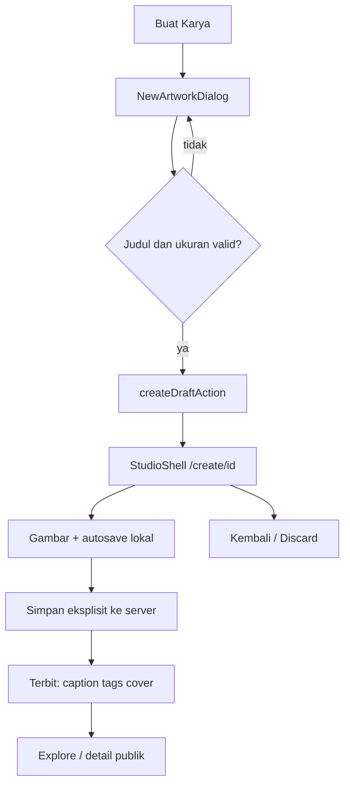

# THE COMMONS — Pixel Studio Redesign Blueprint

**Dokumen:** PIXEL-STUDIO-REDESIGN-BLUEPRINT.md  
**Tanggal:** 18 Nov 2026  
**Sifat:** Audit + spesifikasi desain. **Bukan izin implementasi.** Tidak mengubah source, CSS, skema, migrasi, RLE, atau UI.  
**Status:** Menggantikan asumsi layout di `PIXEL-EDITOR-UI-UX-REDESIGN.md` (bagian workspace) dan urutan chrome di `PIXEL-EDITOR-IMPLEMENTATION-ROADMAP.md` P0. Inventaris fitur kode tetap di `WPLACE-STUDIO-FEATURE-AUDIT.md`.  
**Identitas visual:** Classic Pixel Adventure (`PIXEL-ART-DESIGN-SYSTEM.md`) — Paper, Earth 3px, Brick CTA, `PixelIcon`, block shadow. **Bukan** skin Wplace (abu, radius besar, DaisyUI, logo, ikon, copy proprietary).  
**Referensi workflow:** dua screenshot Overlay Pixel Editor + dialog New Overlay; DOM live `overlay-pixel-editor` / `overlay-project-form` (18 Nov 2026). Hanya struktur dan hirarki, bukan aset.

Batasan yang **tidak** diadopsi dari Wplace: sisi 4096, luas 16_777_216, Google Drive, overlay peta, alliance, charges, “Save to overlay”.

Batasan THE COMMONS yang **wajib** dipertahankan:

| Konstanta | Nilai |
|---|---|
| Sisi | 8–1024 (`PIXEL_CANVAS_MIN` / `PIXEL_CANVAS_MAX`) |
| Luas | ≤ 262_144 (`PIXEL_CANVAS_AREA_MAX`) |
| Palet | index 0 = Paper `#FFFDF7`, max 64 |
| Source / cover | 512 KiB |
| Encoding | `PixelSourceV1` RLE indexed |
| Preset | `PIXEL_SIZE_PRESETS` (square Explore + wide/tall `custom`) |

---

## 0. Keputusan produk (mengganti asumsi lama)

Asumsi lama yang **dibatalkan** oleh dokumen ini:

1. Editor cukup “form komunitas + kanvas + toolbar bawah / strip kontekstual”.
2. Palet cukup sebagai deretan swatch di bawah kanvas (desktop).
3. Pengaturan tool (brush, simetri) boleh hidup di strip horizontal permanen.
4. `/create` adalah halaman form ukuran tanpa judul wajib (`DRAFT_UNNAMED_TITLE`).
5. Metadata komunitas (caption, tags) boleh dicampur ke momen pembuatan kanvas.
6. Layout P0 yang sudah ada (header + rail kiri + strip bawah + status) dianggap selesai — itu **fondasi parsial**, bukan target.

Keputusan baru:

| Keputusan | Isi |
|---|---|
| Layout target | Aplikasi kreatif desktop: header, tool rail kiri, stage tengah, inspector kanan, minimap mengambang di stage, status bar bawah |
| Buat Karya | Modal konfigurasi **sebelum** editor; judul **wajib** |
| Publish | Caption, tags, cover, kategori, izin unduh — **hanya** di alur Terbit |
| Mobile | Bukan desktop yang diperkecil: dock bawah + sheet/tab inspector |
| Data | Redesign presentasi + validasi judul create; **tidak** bump RLE, **tidak** naikkan area/payload |

Evaluasi redesign menyeluruh: **ya — shell `PlaygroundForm` dan halaman `/create` diganti strukturnya**, dengan `PixelBoard` engine tetap. Bukan skin di atas layout lama.

---

## 1. Perbandingan layout (Wplace × THE COMMONS hari ini × target)

### 1.1 Screenshot 1 — Overlay Pixel Editor

| Zona Wplace | Perilaku | Commons hari ini (18 Nov 2026) | Target Commons |
|---|---|---|---|
| `editor-header` | Back, judul, “pixel editor · W×H”, zoom −/%/+, Canvas size, Pixel grid, undo/redo, Discard, Save | Header komunitas (Back, judul, Simpan/Pratinjau/Terbit/⋯) + zoom/grid/undo **di header desktop**; mobile zoom di dock | Satu header studio: judul + dimensi + zoom + ukuran kanvas + grid + undo/redo + Discard + status simpan. Terbit **tidak** mendominasi baris ini |
| `editor-tool-rail` kiri | Brush kotak/lingkaran, bucket, polygon, line, rect, ellipse, bezier, eraser, picker, move, text, gradient, box/contiguous/color/lasso select | Rail kiri desktop (9 tool); mobile rail bawah | Rail kiri desktop penuh; urutan + divider seperti referensi; tool yang belum ada = slot disabled atau P1+ (lihat §5.2) |
| `editor-stage` | Kanvas fleksibel, badge W×H + nama tool | `PixelBoard` flex-1, padding 8–12px | Stage `flex-1 min-h-0`; padding minimum; artwork hero |
| `editor-minimap` | Live Preview, collapsible, ukuran | Belum | Floating pojok stage, Earth frame, click-to-pan, collapse |
| `editor-inspector` kanan | Shortcuts, warna aktif, palet grid, opsi tool, layers | Palet deret bawah desktop; brush/symmetry strip | Panel kanan scroll: shortcuts, warna aktif, palet, opsi tool. Layers **nanti** (arsitektur Opsi B) |
| `editor-status-bar` | x,y · warna · unsaved · hint pintasan | Status: ukuran · alat · simpan · hint (tanpa koordinat kursor) | Koordinat kursor, warna aktif + HEX, hint kontekstual |
| Mobile dock | Zoom, lock, grid, preview; tab Color / Tools / Layers | Toolbar bawah: view row + tools + brush + palet | Tab inspector + sheet; canvas max; jangan tumpuk semua panel |

### 1.2 Screenshot 2 — New Overlay / New Artwork

| Zona Wplace | Commons hari ini | Target Commons |
|---|---|---|
| Dialog “New Overlay” | Halaman `/create` penuh (`PixelNewForm`) di dalam PublicShell | Modal di atas konteks “Buat Karya” |
| Name (max 80) | Judul **tidak** diminta; hidden `DRAFT_UNNAMED_TITLE` | Field judul **wajib**, `CREATION_TITLE_MAX` = 80 |
| Width / Height + preset 16/32/64/128 | Preset Commons lengkap + custom; tanpa judul | Preset `PIXEL_SIZE_PRESETS` + custom; **bukan** 4096 Wplace |
| Canvas background Transparent / Light / Dark | Selalu Paper kosong | Tiga opsi yang dipetakan ke Paper/Ink Commons (§4.4) |
| Preview proporsi + W×H + pixel count | Preview 96px + label ukuran | Preview proporsi + W×H + total piksel + swatch latar |
| Back + Open pixel editor | CTA “Mulai” full-width | Batal / Kembali + **Buka editor piksel** disabled sampai judul + ukuran valid |

### 1.3 Jarak produk (ringkas)

Commons **sudah** punya engine pixel-perfect, undo 32, draft LS/IDB, publish RLE, rail kiri parsial, context menu, zoom header. Yang **belum** vs referensi studio: inspector kanan, minimap, modal create + judul wajib, koordinat status, Discard yang jelas, Canvas size sebagai kontrol header, tool settings di panel (bukan strip), tab mobile inspector.

---

## 2. Rancangan struktur komponen baru

Shell situs **tidak** terlihat di studio (`body.playground-open` + `fixed inset-0` — sudah). Jangan mengembalikan `md:top-[66px]`.

```
Buat Karya (dashboard / nav / /create)
  └── NewArtworkDialog
        ├── NewArtworkFields (title, size, background)
        ├── NewArtworkPreview
        └── createDraftAction → redirect /create/[id]

/create/[id] → StudioShell (pengganti hirarki chrome PlaygroundForm)
  ├── StudioHeader
  ├── StudioWorkspace
  │     ├── StudioToolRail          (desktop)
  │     ├── StudioStage
  │     │     ├── PixelBoard (chrome={false} — engine tetap)
  │     │     ├── StudioMinimap
  │     │     └── StudioStageBadges (W×H, nama tool; hide 2s)
  │     └── StudioInspector         (desktop)
  │           ├── ShortcutsDisclosure
  │           ├── ActiveColorCard
  │           ├── PalettePanel
  │           ├── ToolOptionsPanel
  │           └── LayersPanel*      (setelah Opsi B)
  ├── StudioStatusBar
  ├── StudioMobileDock              (< md)
  │     ├── MobileViewControls
  │     ├── MobileToolRail
  │     └── MobileInspectorTabs → sheet
  ├── StudioContextMenu             (sudah ada)
  ├── PublishDialog                 (caption, tags, izin, konfirmasi nama)
  └── DetailsDialog                 (edit metadata kapan saja, bukan syarat create)
```

\* LayersPanel tidak dirender sampai model layer disetujui. Jangan panel kosong.

**File target (saat implementasi nanti, bukan sekarang):**

| Komponen | Peran | Sumber sekarang |
|---|---|---|
| `NewArtworkDialog` | Modal create | Logika `PixelNewForm` + judul + background |
| `StudioShell` | Grid workspace | `PlaygroundForm` layout |
| `StudioHeader` | Chrome atas | header + `renderViewControls` |
| `StudioToolRail` | Alat vertikal | `toolButtons` |
| `StudioInspector` | Panel kanan | `paletteRow` + brush/symmetry + ColorPicker |
| `StudioMinimap` | Overlay stage | baru; baca buffer `PixelBoard` |
| `StudioStatusBar` | Footer | `renderStatusBar` + kursor |
| `PixelBoard` | Engine | **pertahankan** API handle |

`PixelBoard` tetap pemilik ImageData, kamera, stroke, history, export RLE/PNG. Chrome studio **tidak** pindah ke dalam board (`chrome={false}`).

---

## 3. Interaction flow



### 3.1 Create

1. Pengguna memilih Buat Karya (dashboard, tab Create, atau `/create`).
2. Modal terbuka. Fokus ke field judul.
3. Isi judul, pilih preset atau custom, pilih latar.
4. Preview hidup mengikuti width/height/background.
5. **Buka editor piksel** memanggil `createDraftAction` dengan `title` nyata (bukan `DRAFT_UNNAMED_TITLE`), `width`, `height`. Latar gelap = source awal terisi Ink (lihat §4.4).
6. Redirect `/create/[id]` — editor fullscreen.

Kegagalan: `invalid_input` (judul kosong / terlalu panjang / ukuran ilegal), `limit_reached`, `not_authenticated` — Alert di dalam modal; **jangan** buka editor.

### 3.2 Edit di studio

- Ganti tool: klik rail atau shortcut.
- Inspector menampilkan opsi **hanya untuk tool aktif**.
- Stroke → debounce 400 ms `writeLocalCreationSource` (kontrak sekarang).
- Judul inline → `touchMetadata` + localStorage meta (kontrak sekarang).
- Simpan: upload source + cover seperti sekarang.
- Terbit: dialog metadata komunitas; **bukan** modal create.

### 3.3 Discard vs Kembali vs Hapus

| Aksi | Syarat | Efek |
|---|---|---|
| **Kembali** | Apa saja | `leave()` yang sudah ada: simpan jika dirty, lalu navigasi; virgin draft tetap `discardVirginPixelDraftAction` |
| **Discard** (header) | Ada dirty lokal atau buffer ≠ last server | Konfirmasi: buang perubahan belum tersimpan; restore `initialSource` / last successful save; clear local source; undo stack reset |
| **Discard** | Virgin, belum stroke, belum metadata | Sama dengan batal create: hapus draft virginal, keluar |
| **Hapus karya** | Tetap di menu ⋯ | Dialog hapus yang sudah ada — **bukan** Discard |

Discard **tidak** unpublish karya terbit.

### 3.4 Publish (tidak berubah secara data)

Setelah judul ada sejak create:

1. Pengguna menekan Terbit.
2. Jika judul masih unnamed (karya lama): dialog nama seperti sekarang.
3. Caption, tags, `allow_png_download`, kategori (dari ukuran, bukan input bebas) di dialog Details / Publish.
4. Cover PNG native opaque dari flatten buffer.
5. Explore memakai header + cover yang sama.

---

## 4. Spesifikasi modal pembuatan karya

### 4.1 Chrome modal

- Komponen: `Dialog` Commons (border Earth, bukan `modal-box` Wplace).
- Judul dialog: “Karya baru” / “New work”.
- Subjudul: “Atur kanvas sebelum membuka editor.”
- Desktop: dua kolom — form kiri, preview kanan (seperti screenshot 2).
- Mobile: satu kolom, preview di atas field, footer sticky aman dari tabbar (`bottom-[calc(4rem+safe-area)]` jika masih di halaman bertab; jika overlay penuh, `pb-safe` saja).
- Tutup: Batal, backdrop, Escape — **tanpa** insert row.

### 4.2 Field

| Field | Wajib | Aturan |
|---|---|---|
| Judul | Ya | Trim; 1–80 karakter; tolak `isUnnamedTitle` / hanya spasi; placeholder “mis. Naga biru” |
| Lebar | Ya | Integer 8–1024 |
| Tinggi | Ya | Integer 8–1024 |
| Preset | — | `PIXEL_SQUARE_PRESETS` + `PIXEL_ASPECT_PRESETS` + Custom |
| Latar | Ya, default Paper | `paper-checker` \| `paper-solid` \| `ink` |

Custom: tampilkan hint sisi + luas. Disable submit jika `!isPixelCanvasSize` atau judul invalid. Pesan `sizeRangeError` / `sizeAreaError` yang sudah ada.

### 4.3 Preset (tetap Commons)

Tampilkan label dari `pixelSizePresetLabels`. Jangan 16/32/64/128 saja seperti Wplace — tampilkan **seluruh** preset THE COMMONS:

16×16, 32×32, 64×64, 128×128, 256×256, 512×512, 480×270, 640×360, 270×480, 360×640, plus Custom.

Default: `PIXEL_DEFAULT_PRESET` (`sprite` 64×64).

### 4.4 Canvas background — pemetaan ke model indexed

Wplace punya alpha nyata. Commons **tidak**: Paper = kosong, unduh transparan = punch Paper.

| Opsi UI | Preview modal / stage | Isi buffer awal | Palet awal | Unduh PNG |
|---|---|---|---|---|
| **Transparan** | Checker 8px Earth/Soft | Semua index 0 | `[Paper]` | Transparan = Paper punch (perilaku unduh sekarang) |
| **Terang** | Isi Paper `#FFFDF7` | Semua index 0 | `[Paper]` | Sama; stage editor tanpa checker |
| **Gelap** | Isi Ink `#20202A` | Semua index 1 | `[Paper, Ink]` | Piksel Ink solid; Paper hanya jika dihapus |

Implikasi: Transparan vs Terang **identik di RLE**. Perbedaan hanya preferensi tampilan stage (`data-stage-ground="checker" | "paper"`), disimpan di metadata lokal (`commons:creation-meta`) **bukan** di `source.json`, agar karya lama tetap valid. Gelap menulis piksel nyata — masuk `color_usage` jika terbit tanpa dihapus.

Jangan simpan background sebagai kolom DB baru pada fase ini.

### 4.5 Preview

- Kotak stage ~ 220×220 desktop; contain proporsi `width:height` (bukan scale ke 1024 seperti `PixelNewForm` hari ini yang menyesuaikan ke `PIXEL_CANVAS_MAX` — ganti ke rasio aktual).
- Label: `formatPixelSize` + `"{n} piksel"` (`width * height` dengan pemisah ribuan locale).
- Swatch latar sesuai opsi.
- Tidak ada peta / “centered on map view”.

### 4.6 Aksi

- **Kembali / Batal:** tutup modal.
- **Buka editor piksel:** submit; pending = `sizeStarting`; sukses = redirect editor.

### 4.7 `/create` page

Halaman boleh menjadi **host modal + inspirasi**, bukan form panjang. Entry lain (CTA dashboard) membuka modal yang sama. Jangan buat route baru.

Karya lama tanpa judul tetap bisa dibuka di editor; publish masih memaksa nama. Create **baru** tidak boleh unnamed.

---

## 5. Spesifikasi workspace editor

### 5.1 Header

Urutan kiri → kanan (wrap hanya jika `lg` tidak muat; prioritas: Back, judul, aksi simpan):

1. Kembali (`leave`)
2. Blok judul: input judul (sans, bukan pixel body); baris kedua `W×H` · “editor piksel”
3. Zoom well: −, `output` % atau `N×` / Muat, +
4. **Ukuran kanvas** — buka dialog. P0–P1: **read-only** (dimensi immutable). Salin: “Ukuran terkunci setelah dibuat.” P2: crop/expand sesuai arsitektur.
5. Toggle kisi (`aria-pressed`)
6. Undo / Redo
7. Discard (ghost/danger, konfirmasi)
8. Status simpan teks (`Tersimpan` / `Belum tersimpan` / `Menyimpan…`) — bukan tiga CTA besar
9. Overflow ⋯ : Pratinjau, Terbit, Details, unduh, palet manage, hapus
10. Terbit tetap **satu** kontrol terlihat (Brick) — produk komunitas; jangan disembunyikan total

Simpan draft: ikon disket muncul hanya jika dirty (perilaku sekarang) **atau** selalu enabled no-op jika bersih — pilih **muncul jika dirty** agar kanvas tetap hero.

### 5.2 Left toolbar

Vertikal, `w-[3.5rem]`, ikon 24px, hit 44×44, `aria-pressed`, tooltip `pixelToolWithShortcut`.

Urutan target (divider = `editor-tool-divider` Commons: garis Earth 3px):

**Gambar:** Pencil (B), Eraser (E), Fill (G), Line (L), Rect (U), Ellipse (O)  
**Navigasi / sampel:** Eyedropper (I), Pan (H)  
**Seleksi:** Select rect (V)

Slot P1+ (tampil disabled dengan tooltip “Menyusul” **atau** ditahan sampai alat siap — jangan ikon palsu yang tidak menggambar):

| Slot referensi | Commons | Fase |
|---|---|---|
| Square / circle brush | Mode kuas di inspector, bukan dua tool | P1 |
| Polygon | Tool baru | P1 |
| Bézier | Tool baru | P2 |
| Text | Raster ke palet | P2 |
| Gradient | Bake + optional dither | P2 |
| Lasso / contiguous / by color | Mask seleksi | P1–P2 |
| Move tool terpisah | Seleksi+drag sudah ada | Jangan duplikat |

### 5.3 Stage / kanvas

- `flex-1 min-h-0`; hapus padding besar yang membuat “kartu form”.
- Pertahankan integer device scale, `imageSmoothingEnabled = false`, dirty flag, pinch/pan/Space.
- Badge mengambang: `128 × 128 kanvas` + nama tool; auto-hide.
- Context menu: undo, paste, select all, fit, grid (sudah).
- Semua aspect ratio preset harus muat (contain); jangan pangkas stage.

API baru yang dibutuhkan (spesifikasi, belum kode): `onPointerCell?: (x, y \| null) => void` untuk status bar; `onViewChange` untuk minimap (scale, origin, viewport rect); `getThumbnailImageData()`.

### 5.4 Right inspector

Lebar ~ 260–300px, `overflow-y-auto`, `pixel-scrollbar` Commons, collapsible ke strip 44px (warna aktif saja).

Blok atas → bawah:

1. **Keyboard shortcuts** — `<details>`; daftar B E V G I L U O H, Ctrl+Z/Y, Space, `[` `]`, klik kanan. Bukan settings keymap P3.
2. **Warna aktif** — swatch 36px+, nama jika curated, HEX, index palet.
3. **Palet** — heading + “Semua warna N”; grid swatch 28–32px; Paper tidak di deretan tinta; tombol kelola → `DocumentPaletteDialog`.
4. **Opsi tool** (berganti):
   - Pencil / eraser / line: brush size, square vs circle (P1), symmetry switches (bukan `<select>` tersembunyi)
   - Rect / ellipse: filled vs stroke (ganti Alt tersembunyi)
   - Fill: contiguous only (tolerance off)
   - Select: cut/copy/paste/delete/flip
5. **Layers** — jangan render sampai Opsi B.

Inspector **bukan** tempat caption/tags.

### 5.5 Minimap

- Posisi: kanan-bawah stage, `pointer-events` pada panel saja.
- Thumbnail nearest-neighbor dari buffer 1:1, max sisi ~ 176px, throttle ke dirty flag.
- Rect viewport mapped dari kamera; klik = pan origin agar titik itu ke tengah (clamp).
- Collapse header “Pratinjau” (−/+).
- Mobile: tombol di view dock membuka minimap overlay; default collapsed.

### 5.6 Status bar

Satu baris 12px muted:

`x {n}, y {n}` · `{Color name} {#hex}` · `{saveLabel}` · hint: `Ctrl+Z urung · Spasi geser · Klik kanan menu`

Jika kursor di luar kanvas: `x —, y —`.

---

## 6. Adaptasi mobile

Bukan `md:` hide inspector lalu menumpuk palet di bawah tools (itu layout lama).

### 6.1 Struktur `< md`

```
Header tipis: Back · judul truncated · ⋯ · Terbit
Stage flex-1 (max)
Status 1 baris (koordinat boleh disembunyikan jika sempit)
Dock:
  view controls (zoom, grid, undo, minimap toggle)
  tool rail horizontal scroll (44px)
  tabs: Palet | Alat | (Layers nanti)
Sheet (tinggi 120–420px, resize handle opsional P1):
  konten tab aktif — sama dengan inspector
```

### 6.2 Pola sentuh

- Pinch zoom / pan — sudah.
- Long-press → context menu (sudah); jangan bentrok pan: threshold + cancel jika move > N px (PixelBoard harus tetap menjamin ini).
- Tool settings **hanya** di sheet tab Alat, bukan baris brush selalu terlihat.
- Lock pan opsional (referensi Wplace touch-lock) = P1 jika pinch tertabrak stroke.
- Safe-area: header `pt-safe`, dock `playground-toolbar` `pb-safe`.

### 6.3 Modal create di HP

Full-height sheet; preview compact; CTA “Buka editor piksel” full width di footer.

---

## 7. Dependensi teknis

| Kapabilitas | Sentuh kode | Sentuh data | Risiko |
|---|---|---|---|
| Modal create + judul wajib | `PixelNewForm`, `createDraftAction` / `createDraftSchema`, copy, tes `work-identity` | Row `creations.title` sudah ada; **ubah kontrak** create tidak boleh unnamed | Tes yang mengunci `DRAFT_UNNAMED_TITLE` di form harus diganti; virgin draft tanpa nama tetap untuk karya lama |
| Latar gelap = fill Ink | `emptyCreationContent` / first save source | Source awal index 1; palet `[Paper, Ink]` | Karya baru saja; fork lama tidak berubah |
| Preferensi checker vs paper stage | metadata lokal | `creation-meta` JSON | Hilang jika clear storage; fallback paper-solid |
| Shell inspector + header | `PlaygroundForm`, skeleton, CSS | Tidak | Tes `mobile-chrome` harus diubah saat implementasi |
| Koordinat status | callback `PixelBoard` | Tidak | Pointer events; jangan re-render penuh tiap move — ref + rAF |
| Minimap | baca buffer, kamera | Tidak | Perf; throttle dirty |
| Canvas size dialog read-only | UI | Tidak | Jangan izinkan width/height POST |
| Crop/expand P2 | `updatePixelCreationAction`, local draft size check | Header content width/height | Tinggi — lihat arsitektur §2.5 |
| Layers | Opsi B IDB | Bukan V1 Storage | Terpisah; flatten on publish |
| RLE / IDB / LS / Supabase / Explore | Tidak untuk P0–P1 layout | — | Uji round-trip 16×16 + recovery 640×360 |

`createDraftSchema` hari ini menerima title termasuk unnamed. Spesifikasi: schema create **pixel baru** menolak `isUnnamedTitle`. Update judul di editor tetap memakai `titleForStorage` untuk karya lama yang dikosongkan? **Tidak untuk karya baru.** Editor boleh mengosongkan input visual hanya jika kita tetap menolak blur kosong (restore last non-empty).

---

## 8. Risiko migrasi

| Risiko | Dampak | Mitigasi |
|---|---|---|
| Judul wajib mematahkan tes / alur “Mulai tanpa nama” | Create gagal; virgin-draft semantics | Pertahankan `DRAFT_UNNAMED_TITLE` untuk row lama dan tes unit helper; **hanya** form create baru yang menolak. Discard virgin tetap jalan jika user membuka editor lalu langsung Kembali pada draft bernama tanpa stroke? Produk: draft bernama tanpa stroke = tetap row sampai Discard/Kembali (boleh hapus virginal jika `isVirginPixelDraft` mengabaikan judul). **Keputusan:** virgin = belum ada source server + belum dirty kanvas; judul tidak membatalkan virgin. |
| Latar gelap tanpa tulis source di create | Editor buka kanvas Paper | Generate `PixelSourceV1` awal saat insert **atau** seed di client sebelum paint pertama; jangan ubah header width/height |
| Inspector merampas lebar kanvas | Artwork bukan hero | Collapsible default-open desktop ≥ lg; auto-collapse < 1100px lebar window |
| Dua chrome (P0 parsial + inspector) | Lebih sesak dari sekarang | **Ganti** strip palet bawah desktop dan strip brush; pindah ke inspector. Jangan menumpuk |
| Minimap redraw 262k | Jank HP | Thumbnail max 176px; copy via createImageBitmap / drawImage buffer; 150ms throttle |
| Canvas size button menyesatkan | User kira bisa 4096 | Copy jelas + disable input; jangan pinjam angka Wplace |
| Publish tanpa caption karena create sudah “selesai” | Karya miskin metadata | Alur Terbit tetap nudge caption (dialog yang ada) |
| Kerja identitas `work-identity.test.ts` | CI merah saat implementasi | Update tes bersama form; bukan diam-diam biarkan unnamed |
| Site header muncul lagi | Regresi full-bleed | Pertahankan CSS hide `.site-header` |
| Layers diselipkan terlalu cepat | Panel kosong, payload | Inspector tanpa Layers sampai Opsi B |

**Tidak** migrasi DB untuk blueprint ini. **Tidak** bump `PixelSource` version. **Tidak** naik `PIXEL_CANVAS_AREA_MAX` / 512 KiB.

---

## 9. Identitas visual (anti-clone)

- Token: Paper, Soft, Card, Earth border 3px, Ink text, Brick active tool + Terbit.
- Ikon: `PixelIcon` yang sudah ada; tool baru = glyph original 8-bit, bukan path SVG Wplace.
- Tipografi: pixel font hanya judul dialog/section pendek; field dan status = sans.
- Tidak ada: `btn-circle` glass, `--overlay-ui-*`, logo Wplace, “Save to overlay”, “Live Preview” sebagai merek (gunakan “Pratinjau”).
- Artwork tetap hero di Explore/detail (aturan desain publik yang sudah ada).

---

## 10. Urutan implementasi bertahap (setelah izin terpisah)

Dokumen ini **tidak** mengimplementasikan apa pun. Jika disetujui nanti:

| Fase | Isi | Schema |
|---|---|---|
| **S0** | Modal create: judul wajib, preset Commons, preview, background mapping, CTA Buka editor | Title validation only |
| **S1** | Desktop workspace: header referensi, rail kiri, inspector kanan, status + koordinat; hapus palet/brush strip desktop | Tidak |
| **S2** | Mobile dock + tab sheet inspector | Tidak |
| **S3** | Minimap collapsible + click-to-pan | Tidak |
| **S4** | Tool options eksplisit (fill shape, square/circle brush) di inspector | Tidak |
| **S5+** | Polygon, lasso, crop, layers B — lihat `PIXEL-EDITOR-IMPLEMENTATION-ROADMAP.md` | Sesuai arsitektur |

Jangan S5 sebelum S1: panel kanan kosong tanpa hirarki lebih kacau daripada strip lama.

Uji wajib tiap fase: golden 16×16 stroke/undo; draft IDB refresh 640×360; publish `source.json` = preview; header situs tersembunyi; HP long-press ≠ pan.

---

## 11. Acceptance (definisi selesai desain → nanti implementasi)

- Buat Karya tidak bisa submit tanpa judul valid.
- Modal menampilkan preview rasio, W×H, jumlah piksel, latar.
- Editor desktop = header + rail kiri + stage + inspector kanan + status; kanvas area terbesar.
- Palet dan brush **bukan** strip bawah desktop.
- Terbit tetap meminta caption/tags; create tidak.
- Karya lama RLE V1 terbuka; fork tetap satu lapisan.
- Mobile: sheet/tab, bukan inspector 300px yang dipaksa ke 320px viewport.
- Tidak ada aset/copy merek Wplace.

---

## 12. Dokumen terkait

| Dokumen | Peran setelah blueprint ini |
|---|---|
| `WPLACE-STUDIO-FEATURE-AUDIT.md` | Inventaris fitur × Wplace (fakta kode) — tetap |
| `PIXEL-EDITOR-UI-UX-REDESIGN.md` | Prinsip identitas + anti-pola — layout §3 **diganti** oleh dokumen ini |
| `PIXEL-EDITOR-TECHNICAL-ARCHITECTURE.md` | Risiko layers/RLE/crop — tetap; ditambah catatan judul + fill |
| `PIXEL-EDITOR-IMPLEMENTATION-ROADMAP.md` | Matriks P0–P3 — P0 chrome **diperluas** ke S0–S3 |
| `PIXEL-PLAYGROUND-DESIGN-FEATURES-AUDIT.md` | Kadaluarsa untuk status fitur |
| `PIXEL-ART-DESIGN-SYSTEM.md` | Token visual — tidak diganti |
| `PIXEL-RENDER-EXPORT-BLUEPRINT.md` | Export PNG — orthogonal |
